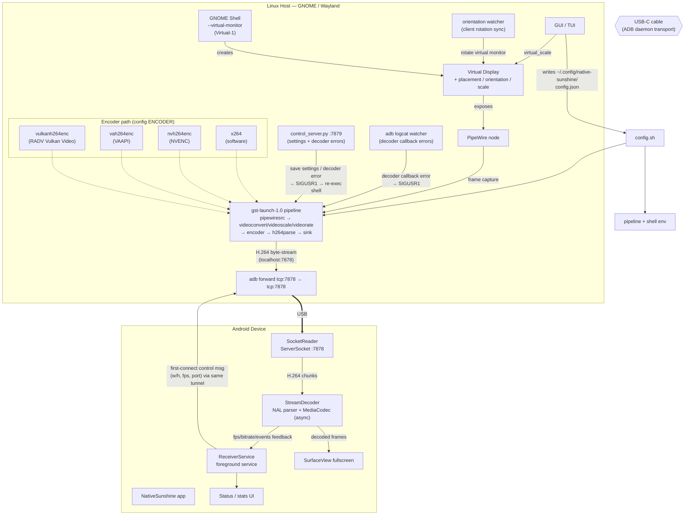
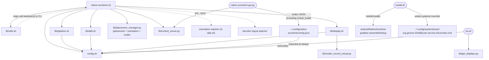
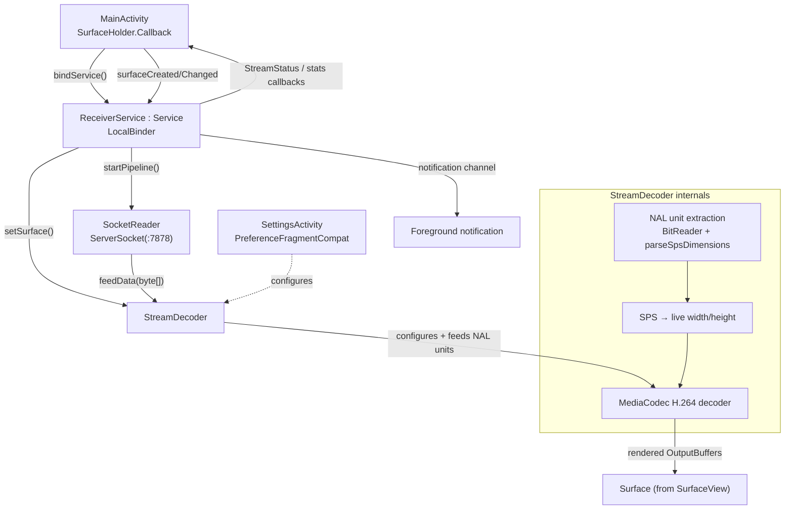

# NativeSunshine — Codebase Graph

> Auto-documented repository map. Rendered best in any Mermaid-capable viewer (GitHub renders these inline).

## 1. What this repo is

**NativeSunshine v1.2.0** turns an Android phone/tablet into a USB-C-attached secondary monitor for a Linux (GNOME/Wayland) desktop. Pixels are captured from a GNOME virtual display, encoded to H.264 on the host (Vulkan Video / VAAPI / NVENC / x264), tunneled through the ADB daemon over USB-C, and decoded on Android via MediaCodec straight to a fullscreen `SurfaceView`. The host supports dynamic orientation and display scale, detects decoder callback errors, and can restart the pipeline to reconnect.

- Language mix: **Bash** (host orchestration), **Python** (DBus/Mutter/GTK glue), **Kotlin** (Android receiver app)
- Entry points: `native-sunshine.sh` (CLI), `native-sunshine-gui.py` (GTK4 GUI), `tui.sh` (whiptail TUI)
- Release: **v1.2.0** (`main`)
- Key defaults: software encoder in `config.sh`; Android host FPS defaults to 60; stream is capped at 120 FPS.

---

## 2. Directory tree

```
NativeSunshine/
├── native-sunshine.sh        ★ Master orchestrator (stream lifecycle, signal teardown, decoder-error watcher)
├── config.sh                 ★ Central config (sourced by everything); imports overrides from ~/.config/native-sunshine/config.json
├── install.sh                   Dependency checker / installer / APK builder / systemd override writer
├── tui.sh                       whiptail configuration menu (writes config.sh)
├── native-sunshine-gui.py       GTK4 GUI (settings → config.json → IPC to running stream)
├── lib/
│   ├── utils.sh                 Logging, dep checks, signal traps   (185 lines)
│   ├── adb.sh                   Device wait/validate + forward + display metrics   (288)
│   ├── display.sh               Virtual-display verify + PipeWire node discovery   (110)
│   ├── pipeline.sh              GStreamer pipeline builders (vulkan/nvenc/vaapi/software)   (430)
│   ├── mutter_record_virtual.py Open Mutter ScreenCast session → returns PW node id   (55)
│   ├── placement_manager.py     DBus display placement, orientation, and scale
│   ├── control_server.py        TCP :7879 settings/error channel → SIGUSR1 restarter
│   ├── portal_screencast.py     XDG portal-based screencast (alternate capture path)   (145)
│   ├── get_pw_node.py           Standalone PW node lookup helper   (52)
│   ├── get_displays.py          Enumerate Mutter monitors for TUI   (32)
│   └── check_monitors.py        Monitor sanity check   (28)
├── android/NativeSunshine/      Android Studio project (Gradle Kotlin)
│   └── app/src/main/java/dev/nativesunshine/
│       ├── MainActivity.kt      Fullscreen SurfaceView host + status overlay   (189)
│       ├── ReceiverService.kt   Foreground service: ServerSocket owner, binds decoder   (255)
│       ├── SocketReader.kt      TCP :7878 server loop (ADB tunnel receiver)   (135)
│       ├── StreamDecoder.kt     NAL parser + MediaCodec async decoder → Surface   (623)
│       └── SettingsActivity.kt  Preferences screen (decoder mode, HW overlays)   (28)
├── docs/                        architecture • host-side • android-side • config-reference • how-to • troubleshooting
├── CHANGELOG.md
└── CODEBASE_GRAPH.md            this repository map
```

---

## 3. End-to-end data-flow graph



---

## 4. Module dependency graph (host side)



---

## 5. Android app component graph



---

## 6. Cross-language call/IPC matrix

| From                                    | To                           | Mechanism                                                         |
| --------------------------------------- | ---------------------------- | ----------------------------------------------------------------- |
| `native-sunshine.sh`                  | `lib/*.sh`                 | `source` (same shell process)                                   |
| `native-sunshine.sh` / `display.sh` | `mutter_record_virtual.py` | subprocess → stdout (PipeWire node id)                           |
| `native-sunshine.sh`                  | `placement_manager.py`     | CLI argv (placement, orientation, scale percentage)              |
| GUI `native-sunshine-gui.py`          | `config.json`              | file write → re-read by `config.sh`                            |
| GUI                                     | `control_server.py`        | TCP `:7879` JSON messages                                       |
| `control_server.py`                   | `native-sunshine.sh`       | `kill -USR1 <parent_pid>` on settings change or decoder error     |
| Android logcat watcher                | `native-sunshine.sh`       | `kill -USR1 <parent_pid>` on decoder callback error               |
| `tui.sh`                              | `config.sh`                | `sed` rewrites                                                  |
| `adb.sh`                              | Android                      | `adb forward`, `adb shell dumpsys` (display metrics)          |
| Host pipeline                           | APK                          | H.264 over `localhost:7878` → adb tunnel                       |
| APK                                     | Host                         | first-connection control message written back through same socket |

---

## 7. Observations / notable signals

1. **Layered host pipeline**: transport, display acquisition, encoding, and process lifecycle are separated across `adb.sh`, `display.sh` and Mutter helpers, `pipeline.sh`, and `native-sunshine.sh`.
2. **Virtual display controls**: the GUI stores a placement and a `virtual_scale` percentage; `placement_manager.py` applies layout, orientation, and the closest supported Mutter scale.
3. **Decoder self-recovery**: Android reports decoder callback errors over the control channel, while a host `adb logcat` watcher supplies an independent trigger. Either can signal the orchestrator to restart and reconnect.
4. **Frame-rate behavior**: Android's Host FPS preference defaults to 60. Host display metrics are detected at startup when no positive override is supplied, and the pipeline caps streaming at 120 FPS.
5. **Encoder choices**: four GStreamer encoder paths are available. `config.sh` defaults to `software`; the GUI initially selects `vulkan`.
6. **Port coupling**: `ADB_STREAM_PORT` in `config.sh` must match the Android `stream_port` preference and the receiver's default port (7878).
7. **Restart semantics**: settings changes, orientation changes, and decoder callback errors signal `SIGUSR1`; the orchestrator stops and re-execs to rebuild the pipeline.
